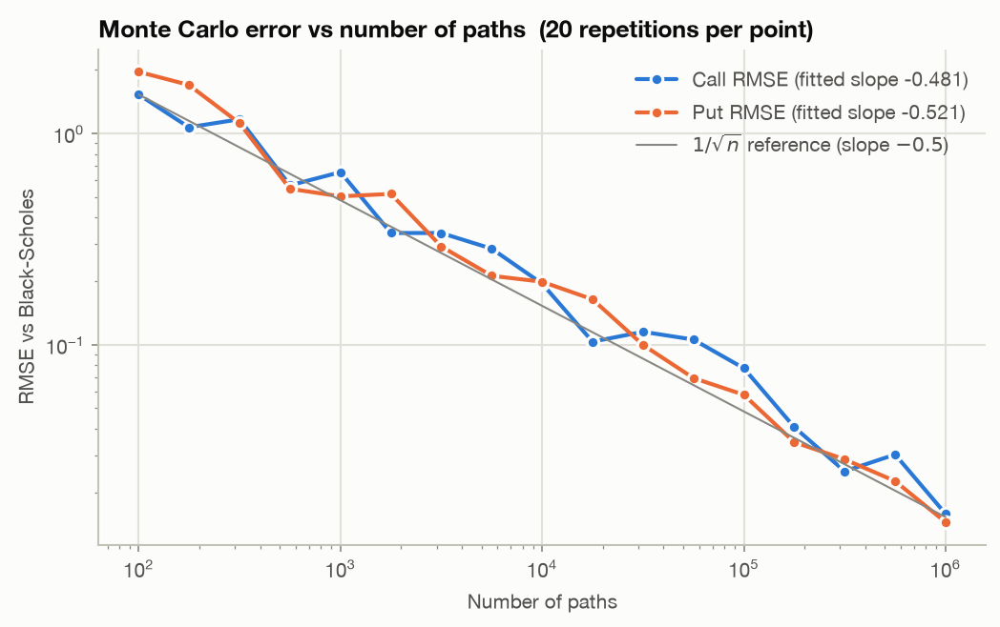
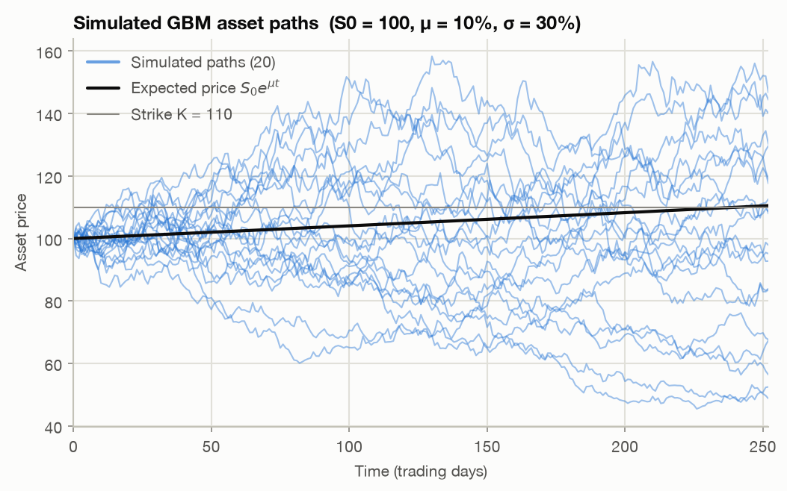

# Option Pricing using a Monte Carlo Simulation

This project prices European call and put options by Monte Carlo simulation and benchmarks the results against the analytical Black-Scholes price. The underlying asset follows geometric Brownian motion, and prices are simulated under the risk-neutral measure. A Jupyter notebook validates the estimator statistically: confidence intervals, put-call parity, the convergence rate, and sweeps across strike and volatility.

## Key Results

With $S_0 = 100$, $K = 110$, $r = 3\%$, $\sigma = 30\%$, $T = 1$ year and $10^5$ paths:

| Option | Monte Carlo | Std error | 95% CI | Black-Scholes | Error / SE |
|---|---|---|---|---|---|
| Call | 9.2477 | 0.0600 | 9.130 – 9.365 | 9.2400 | 0.13 |
| Put | 15.9650 | 0.0540 | 15.859 – 16.071 | 15.9890 | −0.45 |

Both Black-Scholes prices lie inside the Monte Carlo 95% confidence intervals, and the error falls at the theoretical $1/\sqrt{n}$ rate (fitted log-log slopes of −0.48 for the call and −0.52 for the put, against −0.5 in theory):



## Table of Contents
* [Quick Start](#quick-start)
* [Project Structure](#project-structure)
* [Theory](#theory)
* [Methodology](#methodology)
* [Usage as a Library](#usage-as-a-library)
* [Notebook](#notebook)
* [Limitations](#limitations)
* [Roadmap](#roadmap)
* [Dependencies](#dependencies)
* [References](#references)
* [License](#license)

## Quick Start

1. Clone the repository and move into it:
   ```bash
   git clone https://github.com/mikereg/Monte-Carlo-Option-Pricing
   cd Monte-Carlo-Option-Pricing
   ```
2. Create and activate a virtual environment, then install the dependencies:
   ```bash
   python -m venv .venv
   source .venv/bin/activate
   pip install -r requirements.txt
   ```
3. Run the pricer, or open the notebook:
   ```bash
   python European_Option.py
   jupyter notebook MC_vs_Black_Scholes.ipynb
   ```

## Project Structure

* `European_Option.py`: the pricing functions (Monte Carlo, Black-Scholes, path simulation) and a command-line comparison
* `MC_vs_Black_Scholes.ipynb`: the analysis notebook, with theory, comparison, convergence and sweeps
* `images/`: figures generated by the notebook
* `requirements.txt`: Python dependencies
* `LICENSE`: MIT license

## Theory

### Geometric Brownian Motion
The underlying asset is assumed to follow a [geometric Brownian motion](https://en.wikipedia.org/wiki/Geometric_Brownian_motion):

$$\frac{dS_{t}}{S_{t}} = \mu\, dt + \sigma\, dW_{t}$$

where $S_t$ is the asset price at time $t$, $\mu$ is the drift of the asset, $\sigma$ is its volatility and $dW_{t}$ is a Brownian increment, normally distributed with mean $0$ and standard deviation $\sqrt{dt}$. By Itô's lemma, the solution over a time step $dt$ is

$$S_{t+dt} = S_t \exp\left(\left(\mu - \tfrac{1}{2}\sigma^2\right)dt + \sigma\, dW_t\right)$$

where the $-\tfrac{1}{2}\sigma^2$ term is the Itô correction.

### Risk-Neutral Pricing
An option's fair value is its expected discounted payoff under the risk-neutral measure, in which the drift $\mu$ is replaced by the risk-free rate $r$:

$$V_0 = e^{-rT}\,\mathbb{E}^{\mathbb{Q}}\left[\text{payoff}(S_T)\right]$$

The real-world drift $\mu$ does not affect the option price; it is only used for the asset path illustration below.

### Black-Scholes Formula
For European options this expectation has a closed form:

$$C = S_0\,N(d_1) - K e^{-rT} N(d_2), \qquad P = K e^{-rT} N(-d_2) - S_0\,N(-d_1)$$

$$d_1 = \frac{\ln(S_0/K) + \left(r + \tfrac{1}{2}\sigma^2\right)T}{\sigma\sqrt{T}}, \qquad d_2 = d_1 - \sigma\sqrt{T}$$

where $N$ is the standard normal CDF. Calls and puts are linked by put-call parity: $C - P = S_0 - K e^{-rT}$.

### Monte Carlo Error
With $n$ paths, the Monte Carlo price is the mean of the discounted payoffs, with standard error $s/\sqrt{n}$, where $s$ is their sample standard deviation. The estimate $\pm\,1.96$ standard errors gives an approximate 95% confidence interval, and the error shrinks like $1/\sqrt{n}$, so each extra decimal place of accuracy costs 100 times more paths.

## Methodology

### Parameters
These are set at the top of `European_Option.py`:
* **S0**: Initial asset price
* **K**: Option strike price
* **r**: Risk-free interest rate
* **sigma**: Volatility
* **T**: Time to expiry (years)
* **n_paths**: Number of simulated paths
* **seed**: Random seed, for reproducible results

### Output
`python European_Option.py` prints a table comparing, for both the call and the put:
* **MC**: the Monte Carlo price estimate
* **SE**: the standard error of that estimate
* **Black-Scholes**: the analytical Black-Scholes price
* **Error**: MC minus Black-Scholes
* **Error/SE**: the error measured in standard errors (values within about ±2 are consistent with sampling noise)

### Implementation Overview

1. **Terminal asset prices**: A European payoff depends only on the asset price at expiry, so the terminal price is sampled exactly in a single step, with no time-stepping needed:
   $$S_T = S_0 \exp\left(\left(r - \tfrac{1}{2}\sigma^2\right)T + \sigma\sqrt{T}\,Z\right), \qquad Z \sim N(0, 1)$$
   All paths are drawn at once as a vectorised NumPy array.
2. **Option payoffs**: The call payoff $\max(S_T - K, 0)$ and put payoff $\max(K - S_T, 0)$ are computed for every path with `np.maximum`.
3. **Discount future payoffs**: Each simulated payoff is discounted to present value with the factor $e^{-rT}$.
4. **Calculate the options' value**: The mean of the discounted payoffs is the Monte Carlo estimate, reported with its standard error.
5. **Compare with Black-Scholes**: The estimate is compared with the analytical Black-Scholes price.

Full price paths, which are only needed for plotting, are generated by `simulate_paths` using the time-step formula above.

### Simulated Asset Paths Illustration
An illustrative example of simulated asset price paths with $S_0 = 100$, $\mu = 0.1$ and $\sigma = 0.3$. For clarity, the illustration shows 20 paths with 252 daily steps; pricing uses $10^{5}$ paths. The dark line is the expected price $S_0 e^{\mu t}$.



## Usage as a Library

```python
import numpy as np
from European_Option import mc_price, black_scholes_price

rng = np.random.default_rng(42)
price, se = mc_price(S0=100, K=110, r=0.03, sigma=0.3, T=1, n_paths=100_000, option="call", rng=rng)
bs = black_scholes_price(S0=100, K=110, r=0.03, sigma=0.3, T=1, option="call")
print(f"MC: {price:.4f} ± {1.96 * se:.4f}   Black-Scholes: {bs:.4f}")
# MC: 9.2477 ± 0.1177   Black-Scholes: 9.2400
```

## Notebook

`MC_vs_Black_Scholes.ipynb` contains:
* **Theory**: GBM, risk-neutral pricing, the Black-Scholes formula and the Monte Carlo estimator
* **Asset paths**: the illustration above
* **Comparison table**: Monte Carlo against Black-Scholes, with standard errors and 95% confidence intervals
* **Put-call parity check** for both methods
* **Convergence**: estimates and confidence bands from $10^2$ to $10^6$ paths, and the error rate measured over 20 repetitions per path count
* **Sweeps**: prices and errors across strikes 70–130 and volatilities 10–60%
* **Conclusions**

## Limitations

* Constant risk-free rate and volatility, with no dividends
* European exercise only
* Plain Monte Carlo with no variance reduction, which is accurate but not the fastest route to a given precision

## Roadmap

* Binomial (Cox-Ross-Rubinstein) tree pricer, benchmarked against Black-Scholes alongside Monte Carlo
* American options with early exercise
* Variance reduction: antithetic variates and control variates
* Greeks (delta, gamma, vega) by Monte Carlo, compared with their analytical values

## Dependencies
All dependencies are listed in `requirements.txt`:
* NumPy
* SciPy
* Matplotlib
* pandas
* Jupyter

## References
* J. C. Hull, *Options, Futures, and Other Derivatives*, Pearson.
* P. Glasserman, *Monte Carlo Methods in Financial Engineering*, Springer, 2003.

## License
[MIT](https://choosealicense.com/licenses/mit/)
